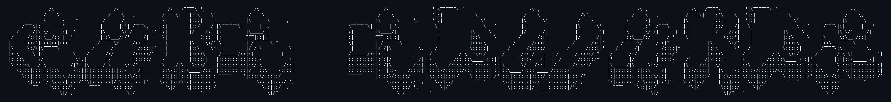

<div align="center">



</div>

---

```console
gabe@mizzou:~$ whoami
gabe edwards — computer science student @ university of missouri

gabe@mizzou:~$ cat /etc/motd
  [+] cybersec SIG member — builds labs, pokes at systems, reads the logs
  [+] ships iOS apps, RL environments, parsers, and the occasional OS
  [+] running: offsec research, openreel — decentralized video on atproto
```

## `> ls ~/projects --featured`

```diff
+ openreel              [TypeScript]  open-source short-form video on the AT Protocol
+ HomeGame              [Swift]       iOS app for home poker nights — buy-ins, cash-outs, who owes who
+ cybersec-sig-labs     [Python]      interactive cybersecurity labs for the Mizzou SIG
+ Tigerhacks-2025       [Python]      reinforcement learning environment, built at TigerHacks
+ Operating-Systems     [C]           kernel-adjacent pain, F2025
+ Be-My-Blank           [JavaScript]  auto-sends holiday messages to the significant other (romance.sh)
+ gabeedwards.com       [HTML]        the personal site — you are here, sort of
```

| repo | what it does |
| --- | --- |
| [**openreel**](https://github.com/OpenReelSocial/openreel) | Open-source short-form video on the AT Protocol. Own your account, pick your algorithm |
| [**HomeGame**](https://github.com/gabeedwards1/HomeGame) | Track home poker games and settle up without the math fight |
| [**cybersec-sig-labs**](https://github.com/gabeedwards1/cybersec-sig-labs) | Hands-on security labs for the Cybersecurity SIG |
| [**Tigerhacks-2025**](https://github.com/gabeedwards1/Tigerhacks-2025) | RL environment from TigerHacks 2025 |
| [**Be-My-Blank**](https://github.com/gabeedwards1/Be-My-Blank) | Automating thoughtfulness, one holiday at a time |

## `> cat ~/.arsenal`

<p>
  
  
  
  
  
  
  
  <br/>
  
  
  
  
  
</p>

## `> ./scan --target=self`

<div align="center">
  
  
  <br/>
  
</div>

## `> ping gabe`

```console
gabe@mizzou:~$ ping -c 3 gabe
PING gabe (gabeedwards.com): 56 data bytes
64 bytes from github.com/gabeedwards1   icmp_seq=0 ttl=64 time=0.42 ms
64 bytes from gabeedwards.com           icmp_seq=1 ttl=64 time=0.37 ms
64 bytes from mizzou.edu                icmp_seq=2 ttl=64 time=0.51 ms

--- gabe ping statistics ---
3 packets transmitted, 3 received, 0% packet loss. say hi.
```

<div align="center">

<a href="https://gabeedwards.com"></a>


<sub>`// connection closed by remote host_`</sub>

</div>
